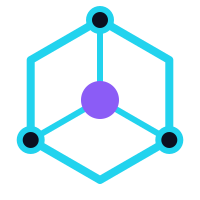
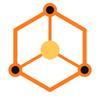
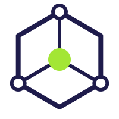

# <p align="center"><br />AgentSINC</p>

<p align="center">
  <strong>Innovation · Network · Collaboration</strong><br />
  <em>An original 3D AI company office and autonomous agent orchestration runtime for the SINC team.</em>
</p>

<p align="center">
  
  
  
  
</p>

---

## 🏢 Overview

**AgentSINC** is an original SINC product built from the ground up as a persistent, secure, and observable AI company workspace. It is an authentic, proprietary software architecture designed from scratch—not a fork, clone, or embed of Hermes3D.

AgentSINC combines an interactive, low-poly 3D office headquarters with an autonomous local agent execution engine. Inside AgentSINC, a founder interacts directly with an AI CEO, while an execution-focused Team Lead coordinates specialized autonomous agents (Developer, Designer, Researcher, and QA Tester). Tasks are decomposed, claimed, safely executed in an air-gapped sandbox, tracked on live workstation screens, and gated by human-in-the-loop approvals.

---

## 🎯 Key Capabilities

- **Interactive 3D Virtual Headquarters**: Built with Three.js and React Three Fiber (R3F). Explore the SINC Command Hub, Development Studio, Design Studio, Research Library, Quality Lab, 4-seat Discussion Room, and Conference Room.
- **Physical Workstation Monitors**: Desks feature real-time offscreen HTML5 2D canvas textures mapped to 3D screens, rendering live agent task names, progress meters, and tool outputs directly in the scene.
- **Two-Tier Orchestration**: Clean separation of concerns between the founder-facing **CEO** (`ceo`) and the operational **Team Lead** (`team_lead`). Supports explicit founder specialist assignments, structured Ollama JSON planning, and deterministic fallback auditing.
- **Role-Scoped Agent Harness**: Autonomous specialist agents operate under strict least-privilege boundaries with an 8-tool call budget per mission.
- **Human-in-the-Loop Approval Queue**: Destructive operations, file modifications (`workspace.write_file`), and mutating external MCP actions are paused in SQLite until explicitly reviewed and approved by the founder.
- **Air-Gapped Docker Sandbox**: Test suites (`pytest`, syntax analysis, TypeScript checking, Next.js build) run inside an isolated Docker container with `--network none`, `--cap-drop ALL`, a read-only source mount, and disposable `tmpfs` execution. Host shell execution is strictly refused.
- **Safe GitHub Delivery Pipeline**: Autonomous GitHub releases follow a hard-gated sequence: Developer implementation → QA test pass required (`exit=0`) → Feature branch push → Pull request creation. Direct writes to protected branches and PR merging are permanently blocked.
- **Zero-Cost Local-First Runtime**: Powered by local LLMs via Ollama (e.g. Qwen 2.5, Qwen 3, Llama 3) with streaming NDJSON, responsive token-level founder cancellation, and SQLite WAL persistence. Operates 100% offline (with optional Gemini 2.5 Flash Google Search grounding for the Research Agent).
- **Accessibility & 2D Fallback**: Includes an interactive `<OfficeMap2D>` floor map for low-power devices and full `prefers-reduced-motion` compliance.

---

## 🤖 The AI Specialist Roster

| Specialist Agent | System Role | Department & Zone | Tools & Capabilities |
|---|---|---|---|
| **SINC CEO** (`ceo`) | Founder Interface | SINC Command Hub | High-level request intake, status oversight, founder communication. |
| **Team Lead** (`team_lead`) | Execution Coordinator | SINC Command Hub | Request decomposition, plan generation, specialist task delegation, result synthesis. |
| **Dev Agent** (`developer`) | Software Engineer | Development Studio | Workspace search/read, atomic code write proposals, sandboxed test validation, GitHub feature branch release. |
| **Design Agent** (`designer`) | UI/UX Designer | Design Studio | Workspace search/read, component styling, design token adjustments, UI code proposals. |
| **Research Agent** (`researcher`) | Technical Analyst | Research Library | Workspace inspection, architecture review, optional Google Search grounding (Gemini 2.5 Flash). |
| **QA Agent** (`tester`) | Quality Engineer | Quality Lab | Sandboxed Docker test suite runner (`tests.run`), regression analysis, release validation gating. |

---

## 🏛️ System Architecture

```text
                                [ Founder ]
                                     │
                        (Browser / HTTPS / 2.5s Polling)
                                     ▼
        ┌─────────────────────────────────────────────────────────┐
        │                 Next.js 16 Web Dashboard                │
        │  • React 19 / TypeScript / Tailwind CSS v4             │
        │  • Three.js / React Three Fiber Procedural 3D Office    │
        │  • Live 2D Canvas Workstation Textures                 │
        │  • Mission Board, Approval Queue & 2D Map Fallback      │
        └────────────────────────────┬────────────────────────────┘
                                     │ JSON API
                                     ▼
        ┌─────────────────────────────────────────────────────────┐
        │                   FastAPI Backend API                   │
        │  • Endpoint routing, task state validation              │
        │  • SQLite (WAL mode) system of record                   │
        │  • Human approval execution boundary                   │
        └─────────────┬─────────────────────────────┬─────────────┘
                      │                             │
                      ▼                             ▼
        ┌───────────────────────────┐ ┌───────────────────────────┐
        │  Local SQLite Persistence │ │  Autonomous Worker Engine │
        │  • agents, tasks, events  │ │  • Lease & 3s heartbeat   │
        │  • orchestrations         │ │  • Crash/restart recovery │
        │  • tool_approvals, memory │ │  • Task queue claiming    │
        └───────────────────────────┘ └─────────────┬─────────────┘
                                                    │
                 ┌──────────────────────────────────┴──────────────────────────────────┐
                 ▼                                                                     ▼
  ┌─────────────────────────────┐                                       ┌─────────────────────────────┐
  │     Local Ollama Runtime    │                                       │   Guarded Execution Tools   │
  │  • Model: Qwen / Llama 3    │                                       │  • Read-only workspace      │
  │  • Streaming token output   │                                       │  • Approval-gated writes    │
  │  • Responsive cancellation  │                                       │  • Isolated Docker Sandbox  │
  └─────────────────────────────┘                                       │  • Role-scoped GitHub MCP   │
                                                                        └─────────────────────────────┘
```

---

## 👥 The SINC Founding Team

Documented in [`team/founding-team.json`](team/founding-team.json):

| Name | Role | Department / Area |
|---|---|---|
| **Elango S** | Founder | Leadership & Architecture |
| **Karmjit SG** | Co-founder | Strategy & Execution |
| **Prajith P** | Co-founder | Operations & Product |
| **Aaditya R M** | Founding Advisor | Advisory & Technology |
| **Vaishnavi M** | Tester | Quality Assurance |
| **Meghana P Banda** | Tester | Quality Assurance |
| **Dhakshatha S** | Developer & Social Media Team | Engineering & Community |
| **Ishita Das** | Designer | UI/UX & Visual Design |
| **Mohana Priya G** | Designer | 3D & Product Design |
| **Dhanusri T** | Tester & Developer | Full-Stack Quality & Dev |
| **Gopika S** | Developer | Core Backend & Runtime |

---

## 🎨 Brand Identity

AgentSINC utilizes a geometric hexagonal network mark representing nodes converging into a central intelligence hub. Three approved identity palettes are preserved in [`docs/BRAND.md`](docs/BRAND.md):

<p align="center">
  
  &nbsp;&nbsp;&nbsp;&nbsp;&nbsp;&nbsp;&nbsp;&nbsp;
  
  &nbsp;&nbsp;&nbsp;&nbsp;&nbsp;&nbsp;&nbsp;&nbsp;
  
</p>

- **Option A (Cyber — Cyan & Violet)**: `#0B1020` base, `#22D3EE` cyan lines, `#8B5CF6` violet hub. *Technical, luminous, futuristic.*
- **Option B (Ember — Charcoal & Amber)**: `#16110D` base, `#FF7A1A` orange lines, `#FFC857` amber hub. *Warm, energetic, bold.*
- **Option C (Indigo — Lime & Indigo)**: `#1E1B4B` base, `#A3E635` lime lines, `#4D7C0F` green hub. *Modern, confident, high contrast.*

---

## 📁 Repository Structure

```text
AgentSINC/
├── AGENTS.md                  # Development instructions & architecture boundaries
├── README.md                  # Project overview, architecture & setup guide
├── backend/                   # FastAPI backend, worker & agent harness
│   ├── app/
│   │   ├── main.py            # API routes, overview snapshot & approval handlers
│   │   ├── orchestrator.py    # CEO/Team Lead planning, delegation & synthesis
│   │   ├── worker.py          # Background polling worker, heartbeat & crash recovery
│   │   ├── harness.py         # Autonomous agent tool loop & approval dispatch
│   │   ├── sandbox.py         # Docker container test runner (--network none)
│   │   ├── agent_write.py     # Atomic, restricted file mutation engine
│   │   ├── workspace.py       # Path confinement, lexical search & safe reading
│   │   ├── mcp_registry.py    # Model Context Protocol (MCP) server registry
│   │   ├── research.py        # Gemini 2.5 Flash Google Search grounding connector
│   │   ├── redaction.py       # Secret & credential scrubbing
│   │   └── db.py              # SQLite schema, WAL configuration & audit events
│   ├── data/                  # Local SQLite database storage (agentsinc.sqlite3)
│   ├── tests/                 # Automated test suite (95 tests)
│   ├── Dockerfile.sandbox     # Air-gapped test execution image
│   └── requirements.txt       # Python dependencies
├── frontend/                  # Next.js 16 web application & 3D office
│   ├── src/
│   │   ├── app/               # Next.js App Router (layout.tsx, page.tsx, globals.css)
│   │   ├── components/office/ # 3D scene (AgentSincScene), viewport & OfficeExperience
│   │   └── lib/               # Typed API client (agentsinc-api.ts)
│   └── package.json           # Frontend dependencies (React 19, R3F, Tailwind v4)
├── docs/                      # Architectural decisions, security policies & phase roadmaps
│   ├── ARCHITECTURE.md        # Technical architecture specifications
│   ├── 3D_OFFICE_DESIGN.md    # 3D office blockout, zones & interaction guide
│   ├── BRAND.md               # Visual identity tokens & guidelines
│   ├── DEPLOYMENT.md          # Local & production operations guide
│   ├── PHASES.md              # Delivery roadmap & phase acceptance criteria
│   ├── PRODUCT_REQUIREMENTS.md# Functional requirements
│   ├── SECURITY.md            # Security posture, isolation & approval policies
│   └── WORKSPACE_SECURITY.md  # Workspace boundary constraints
├── infra/                     # Infrastructure scripts (start-local.ps1)
├── public/brand/              # Scalable vector logo assets
└── team/                      # Public founding-team metadata (founding-team.json)
```

---

## 🚀 Quickstart & Local Setup

### Prerequisites
1. **Node.js**: v20.9.0 or higher.
2. **Python**: v3.11 or higher.
3. **Ollama**: Installed and running locally with at least one model pulled (e.g. `ollama run qwen2.5:7b` or `ollama run qwen3:4b`).
4. **Docker Desktop** *(Optional, recommended for sandboxed test execution)*: Required if running tests via the agent harness. Build the local sandbox image using:
   ```bash
   docker build -t agentsinc-sandbox:local -f backend/Dockerfile.sandbox .
   ```

### 1. Automated Startup (Windows PowerShell)
AgentSINC provides a one-click local startup script:
```powershell
.\infra\start-local.ps1
```
This checks prerequisites, validates the Python virtual environment, ensures Ollama is active, and spawns the FastAPI API and Worker processes.

### 2. Manual Step-by-Step Setup

#### Backend Setup
```bash
# Navigate to backend and create virtual environment
cd backend
python -m venv .venv

# Activate virtual environment
# Windows:
.venv\Scripts\activate
# Linux/macOS:
source .venv/bin/activate

# Install dependencies
pip install -r requirements.txt

# Configure environment
cp .env.example .env

# Initialize database and run automated test suite
pytest

# In Terminal 1: Start the API server
uvicorn app.main:app --host 127.0.0.1 --port 8000 --reload

# In Terminal 2: Start the background worker
python -m app.worker
```

#### Frontend Setup
```bash
# In Terminal 3: Navigate to frontend
cd frontend

# Install dependencies
npm install

# Verify TypeScript compilation
npm run typecheck

# Start Next.js development server
npm run dev
```

Open [http://localhost:3000](http://localhost:3000) in your browser to enter the 3D office.

---

## 🛡️ Security & Delivery Principles

1. **No External Dependencies on Proprietary Competitors**: Built as an original SINC platform without Hermes3D source code or asset dependencies.
2. **Least Privilege by Default**: Agent tools are disabled by default. Tools are scoped by specialist role with strict timeouts and parameter validation.
3. **Immutable Human Gates**: No file write or git publish occurs without explicit founder review in the Approvals queue.
4. **Zero Host Shell Execution**: Test suites are executed strictly inside an air-gapped Docker container (`--network none`, `--cap-drop ALL`, tmpfs).
5. **Truth in Telemetry**: Frontend states, progress indicators, and event timelines are directly bound to durable backend events—never faked with client timers.
6. **Credential Protection**: Automated redaction of secrets, tokens, private keys, and passwords before logging or LLM context ingestion.

---

## 🗺️ Roadmap & Phase Status

- **Phase 1 — Product & Architecture Foundation**: Completed. Requirements, team roster, brand assets, and architecture documented.
- **Phase 2 — UI System & 3D Office Prototype**: Completed. Procedural 3D office, avatars, live workstation screens, and 2D fallback implemented.
- **Phase 3 — Local Runtime & Task Persistence**: Completed. FastAPI, SQLite WAL persistence, Ollama background worker, and agent controls implemented.
- **Phase 4A — Workspace Awareness & Safe Reading**: Completed. Lexical search, path confinement, and secret scrubbing active.
- **Phase 4B — CEO Orchestration & Specialist Handoffs**: Completed. Dual-tier orchestration, planning, task claiming, and synthesis verified.
- **Phase 5 — Guarded Tools, Approvals & GitHub Pipeline**: Completed. Docker sandbox runner, human approval queue, and gated GitHub MCP releases implemented.
- **Phase 3B / 6 / 7 — Enterprise Identity, PostgreSQL & Cloud Hardening**: Planned roadmap capabilities.

---

<p align="center">
  <sub>AgentSINC © 2026 SINC. Built for autonomous intelligence, team collaboration, and human oversight.</sub>
</p>
